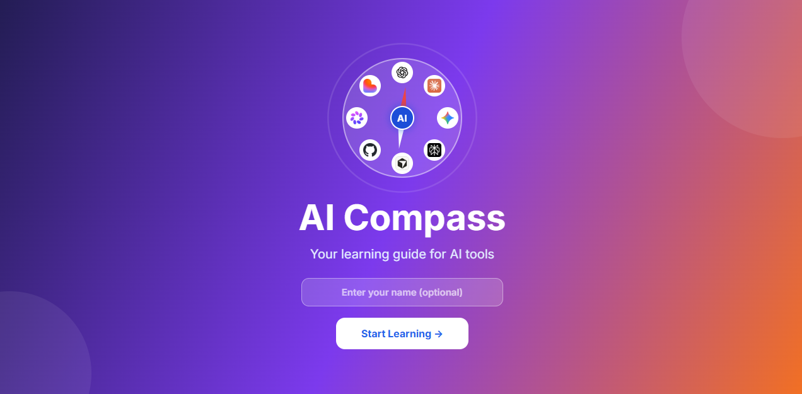
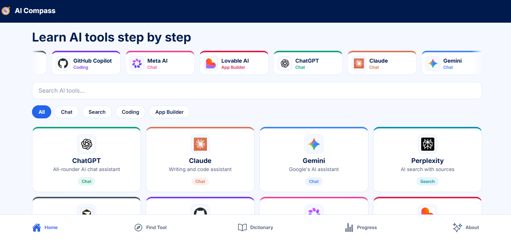
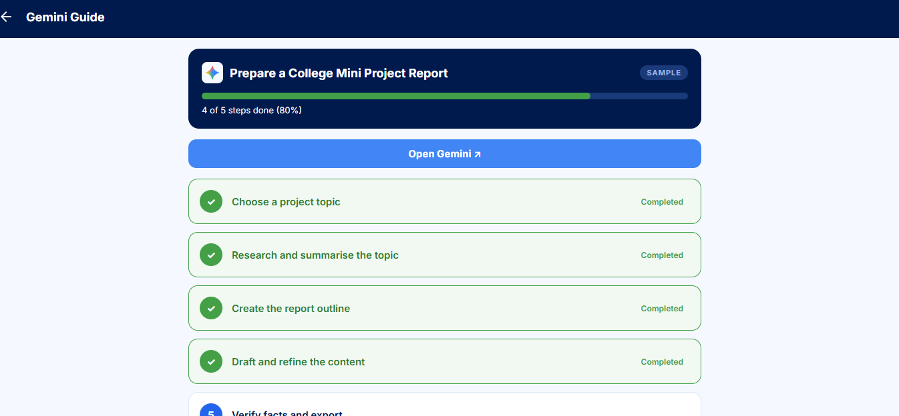
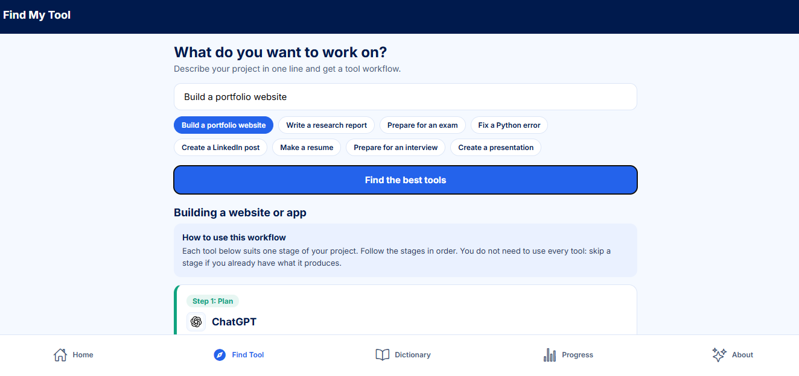

# AI Compass 🧭

A learning app that teaches beginners how to use AI tools step by step, helps them choose the right tool for a project, and explains AI terms in English and Tamil.

**Live demo:** https://YOUR-SITE.netlify.app

## Screenshots

| Splash | Home |
|---|---|
|  |  |

| Step guide | Find My Tool |
|---|---|
|  |  |

## Features

- **8 AI tools**: ChatGPT, Claude, Gemini, Perplexity, Cursor, GitHub Copilot, Meta AI and Lovable, each with speciality, advantages, disadvantages and limitations
- **Step-by-step guides**: a 5-step sample project for every tool, with where and when to use the tool and ready-to-copy prompts
- **Find My Tool**: describe your project and get a workflow of tools for each stage
- **Quizzes**: a 5-question quiz for every tool, with explanations and score feedback
- **AI Dictionary**: AI terms explained in English and Tamil, searchable by word or question
- **Progress tracking**: guide progress and best quiz scores saved on the device
- **Personalisation**: an optional name shown across the app
- **Auto-scrolling tool strip** on the home screen and a **responsive layout** for mobile, tablet and desktop

## Tech stack

React Native, Expo, React Navigation (stack and bottom tabs), AsyncStorage, expo-linear-gradient, expo-clipboard

## Run locally

    npm install
    npx expo start

Press `w` for the web version, or scan the QR code with the Expo Go app on your phone.

## Build for the web

    npx expo export -p web

The output is created in the `dist` folder.

## Project structure

    src/
      components/   ToolCard, ToolLogo, ToolMarquee, HoverCard, UserBadge
      context/      UserContext (saved name)
      data/         tools, recommend, quizzes, dictionary, logos
      hooks/        useResponsive
      navigation/   AppNavigator
      screens/      Splash, Home, ToolDetail, StepGuide, Recommend, Quiz, Dictionary, Progress, About
      theme/        colors, toolColors

## Notes

- Find My Tool and the AI Dictionary use simple built-in rules and data. They do not use a live AI service, so no API keys are needed.
- Tool interfaces and features change over time. If a menu or button looks different, check the tool's official help page.
- Tool names and logos belong to their respective owners and are used only for identification.
- Progress, quiz scores and the name are stored only on the user's device.

## Future improvements

- Sign-in with progress synced across devices (for example Firebase Auth)
- Profile page and learning history
- A separate guide for each project type
- Bookmarks and dark mode
- AI-powered dictionary and recommendations through a secure backend (API key kept on the server)

## Author

Built by Thilagavathi